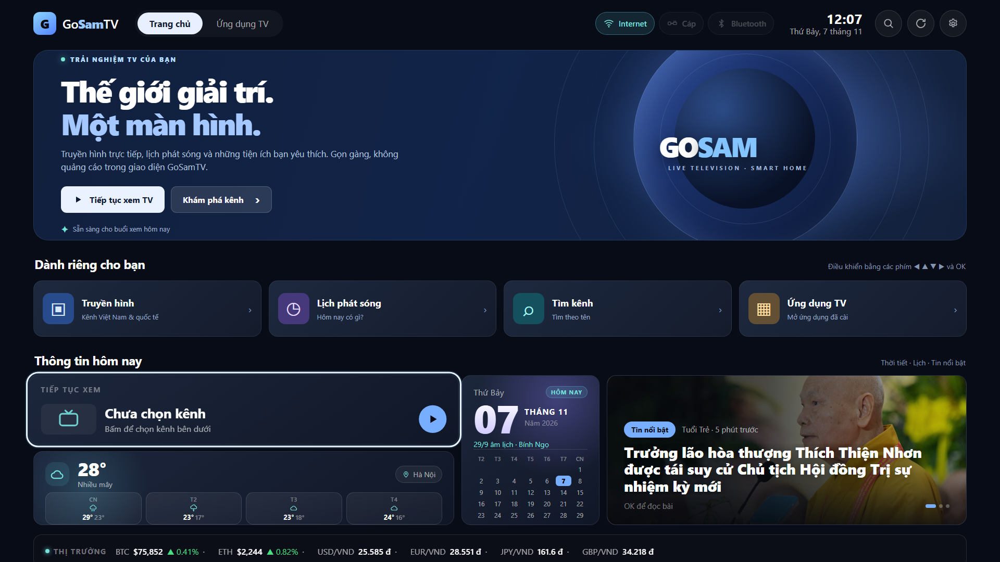
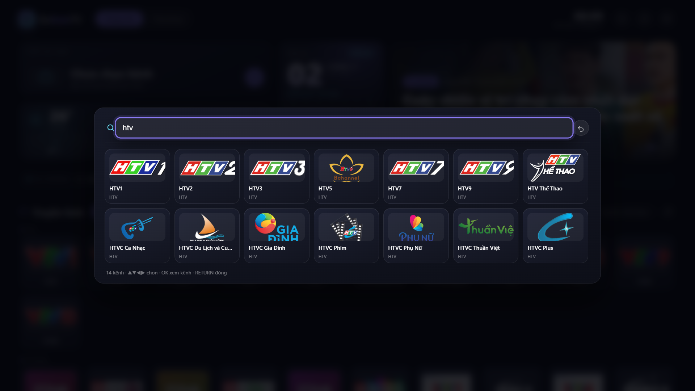
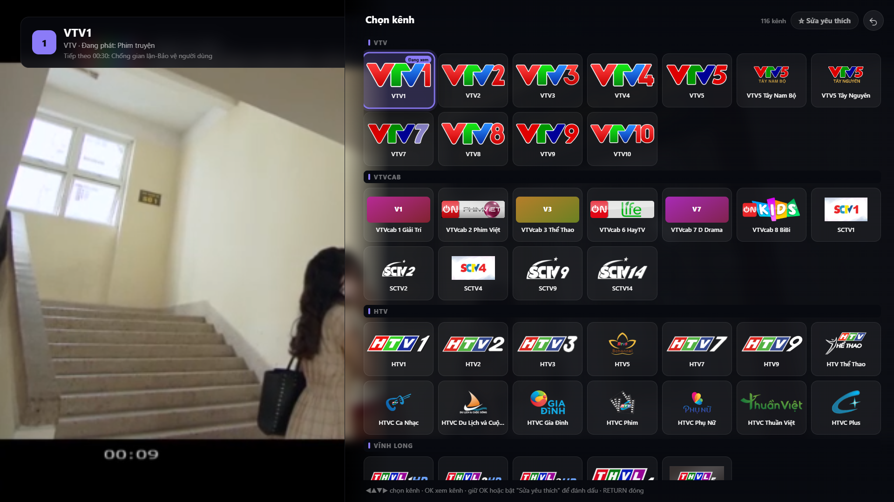
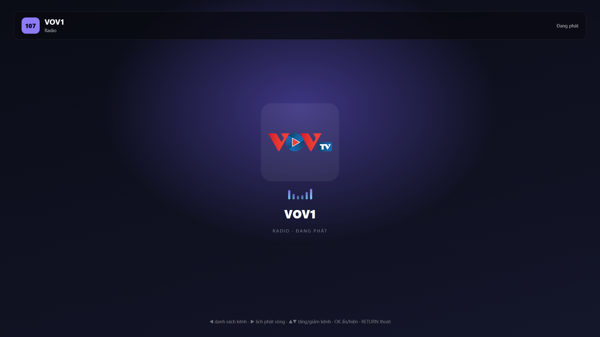
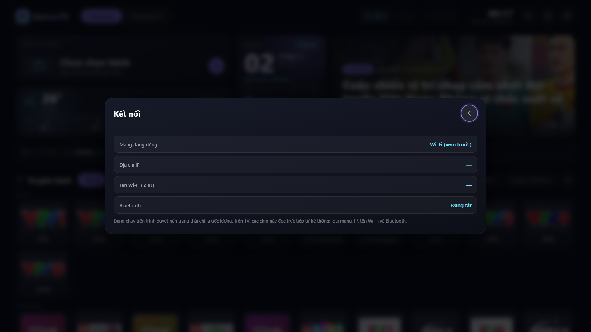
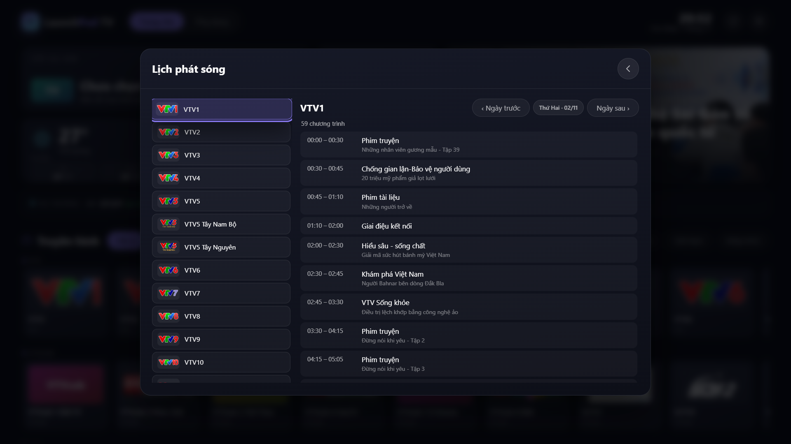
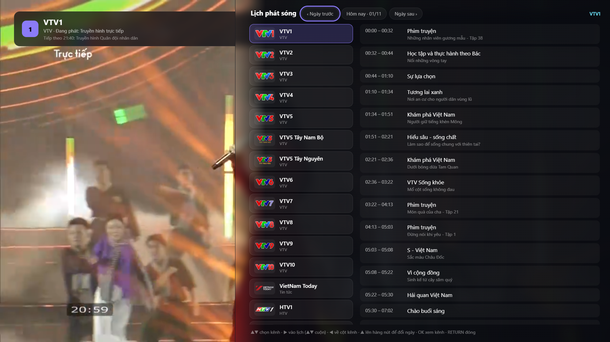

<p align="center">
  
</p>

<h1 align="center">GoSamTV</h1>

<p align="center"><strong>Ứng dụng xem truyền hình Việt Nam cho Samsung Smart TV (Tizen) — gọn, nhanh, điều khiển hoàn toàn bằng remote.</strong></p>

<p align="center">
  
  
  <a href="dist/GoSamTV-1.8.0.wgt"></a>
  
</p>



> **GoSamTV Home 2.0:** Giao diện Home 2.0 theo phong cách Google TV, logo cam–xanh lá, và bản sửa trình phát AVPlay giúp khắc phục tình trạng chỉ có tiếng mà không có hình trên Samsung CU8000. Đã cài và thử nghiệm thực tế trên UA55CU8000KXXV (Tizen 9.0).

**Bản 1.8.0:** Ứng dụng luôn mở ở giao diện Home 2.0, không tự phát lại kênh đang xem. Kênh gần đây chỉ phát khi bạn chọn **Tiếp tục xem TV** hoặc chọn kênh bằng remote. Đã khắc phục tình huống phím OK từ Smart Hub còn được chuyển vào ứng dụng lúc khởi chạy. Giữ nguyên logo cam–xanh lá và sửa lỗi AVPlay đã hoạt động trên Samsung CU8000.

## GoSamTV là gì?

Một giao diện TV dễ sử dụng cho Samsung Tizen, với thanh lối tắt và nội dung hiển thị gọn gàng: **kênh truyền hình**, **lịch phát sóng**, **radio**, **tin tức**,
**thời tiết**, **giá thị trường** và các **ứng dụng khác trên TV** — tất cả trên một màn hình, không cần
cắm box, không cần tài khoản.

Dự án bắt đầu từ một APK Android TV (`launchpad2/tv`) không chạy được trên Tizen, nên toàn bộ giao diện
được dựng lại bằng HTML/CSS/JS thuần và đóng gói thành `.wgt` cho Samsung TV.

## Tính năng

| Nhóm | Nội dung |
|---|---|
| **Trang chủ 2.0** | Banner lớn, lối tắt Truyền hình / Lịch phát sóng / Tìm kênh / Ứng dụng TV, tối ưu điều khiển từ xa |
| **Phát video Samsung** | Dùng AVPlay gốc, hỗ trợ hiển thị hình trên lớp video native; dự phòng HTML5 video cho web |
| **Kênh** | 101 kênh Việt Nam (91 truyền hình + 10 radio) và 509 kênh quốc tế, xếp lưới theo nhóm: VTV, VTVcab, HTV, Vĩnh Long, Miền Bắc/Trung/Nam, Tin tức, Radio |
| **Lịch phát sóng** | EPG theo kênh và theo ngày (VNEPG + XMLTV), bấm ▶ khi đang xem để mở |
| **Tìm kiếm** | Gõ bằng bàn phím ảo của TV, lọc ngay, **không cần gõ dấu** (`vinh long` khớp "Vĩnh Long") |
| **Yêu thích** | Giữ OK trên thẻ kênh để đánh dấu; nhóm ★ Yêu thích luôn nằm đầu danh sách |
| **Radio** | 10 đài (VOV1–VOV5, VOV Giao Thông HN/TP.HCM, Hà Nội FM 90, Hải Phòng FM, XONE, RFI) với màn hình phát riêng |
| **Tin tức** | RSS từ VnExpress, Tuổi Trẻ, Thanh Niên, BBC Việt; thẻ "Tin nổi bật" xoay vòng 3 tin |
| **Tiện ích** | Thời tiết 4 ngày, giá BTC/ETH/USD/EUR/JPY/GBP → VND, lịch âm + lịch tháng mini |
| **TV** | Trạng thái Wi-Fi / Cáp / Bluetooth, mở nhanh ứng dụng đã cài trên TV |
| **Nguồn** | Chuyển Việt Nam ↔ Quốc tế, nhập danh sách M3U riêng |

<p align="center">
  
  
</p>
<p align="center">
  
  
</p>

<p align="center">
  
  
</p>
## Điều khiển bằng remote

| Phím | Khi đang xem kênh | Khi ở trang chủ |
|---|---|---|
| ◀ ▶ ▲ ▼ | ◀ danh sách kênh · ▶ lịch phát sóng · ▲▼ tăng/giảm kênh | di chuyển giữa các thẻ |
| OK | ẩn/hiện thanh thông tin | mở kênh / mở mục đang chọn |
| RETURN | thoát trình phát | đóng bảng đang mở, thoát app |

Trong danh sách kênh: **giữ OK** để thêm/bỏ yêu thích.

## Xem bản web (không cần TV)

**https://saunguyen.github.io/GoSamTV/** — toàn bộ giao diện chạy trong trình duyệt: duyệt kênh, tìm kiếm,
lịch phát sóng, radio, tin tức, thời tiết.

- Trình duyệt không hỗ trợ HLS sẵn (Chrome/Firefox trên PC) sẽ tự nạp `hls.js` để phát kênh.
- Một số kênh chặn CORS khi phát từ web; trên TV thì không bị.
- Trạng thái Wi-Fi/Bluetooth và mở ứng dụng chỉ có trên TV.
## Cài lên TV Samsung

**Cách 1 — Apps2Samsung (dễ nhất)**

1. Bật *Developer mode* trên TV (Apps → nhập `12345` → bật).
2. Cài [Apps2Samsung](https://github.com/Apps2Samsung/Apps2Samsung) trên máy tính.
3. Tải [GoSamTV-1.8.0.wgt](dist/GoSamTV-1.8.0.wgt) từ kho mã nguồn (hoặc [trang Releases](https://github.com/saunguyen/GoSamTV/releases), nếu bản phát hành đã được đăng) rồi chọn **Install a file…** trong Apps2Samsung. Bản này đã ký và cài thử trên Samsung CU8000.

**Cách 2 — Tizen Studio**

```bash
tizen install -n GoSamTV-1.8.0.wgt -t <tên-TV>
```

Gói trong `dist/` đã được ký sẵn bằng chứng chỉ mức **Public** nên cài được trực tiếp, không cần
chứng chỉ Partner. Xem hướng dẫn chi tiết (tiếng Việt) ở [TIZEN.vi.md](TIZEN.vi.md).

## Tải về

[](dist/GoSamTV-1.8.0.wgt)

Bản WGT 1.8.0 đã ký sẵn nằm trong `dist/`; có thể tải trực tiếp từ kho mã nguồn. Trang Releases có thể được cập nhật riêng.

## Tự build

Yêu cầu: Python 3.10+ và bộ chứng chỉ dùng để ký (đặt trong `tools/`, hoặc thay bằng chứng chỉ của bạn).

```bash
python tools/prepare_assets.py     # dựng app/data/channels.js từ nguồn kênh + kết quả dò luồng
python tools/build_wgt.py main     # đóng gói + ký -> dist/GoSamTV-<version>.wgt
```

Xem trước trên máy tính: mở `app/index.html` bằng Chrome (một số tính năng như Wi-Fi, Bluetooth,
mở app khác chỉ chạy trên TV).

## Dữ liệu kênh được kiểm tra thật

Danh sách gốc có rất nhiều link chết, nên app chỉ ship kênh **đã dò thấy luồng thật** (HTTP 200 +
`#EXTM3U`, với master playlist thì tải thêm biến thể đầu tiên):

| Nguồn | Gốc | Sau khi lọc |
|---|---|---|
| Việt Nam (truyền hình) | 122 | **91** |
| Việt Nam (radio) | 11 | **10** |
| Quốc tế | 1.127 | **509** |

- 17 kênh Việt Nam được **thay link mới** (nhóm HTV/HTVC lấy từ CDN công khai, cùng Hà Nội 1, Tây Ninh,
  An Ninh TV, An Giang 2, Quảng Ninh 3, VTVcab 2) — khai báo trong `tools/vn-overrides.json`.
- 31 kênh còn lại chưa có luồng công khai (SCTV1 và phần lớn là đài tỉnh đã sáp nhập).
- Kênh trả về playlist chỉ có ảnh "signal low" cũng bị coi là chết và loại khỏi danh sách.
- Một số link là **link ký có hạn** (ví dụ HTV4 từ TV360): mỗi lần build, `tools/check_overrides.py`
  dò lại `vn-overrides.json` và tự loại link đã hết hạn.

Bộ công cụ: `probe_streams.py` (quốc tế), `probe_vn.py` (Việt Nam), `harvest_vn.py` (tìm link thay thế),
`fetch_news.py` (nhúng bản tin vào gói), `wgtsign.py` (ký và kiểm tra chữ ký `.wgt`).

## Cấu trúc

```
app/                 giao diện (index.html, css/, js/, data/, img/)
  data/channels.js   danh sách kênh đã lọc (sinh tự động)
  data/news.js       bản tin nhúng (sinh tự động mỗi lần build)
tools/               script dò luồng, dựng dữ liệu, đóng gói và ký .wgt
dist/                gói cài đặt .wgt đã ký
screenshots-tizen/   ảnh chụp giao diện
TIZEN.vi.md          hướng dẫn cài đặt & build chi tiết
docs/                bài viết giới thiệu và tài liệu
```

## Lưu ý phát video trên Samsung Tizen

- Trên TV, GoSamTV ưu tiên Samsung AVPlay. Vùng video native nằm dưới lớp WebView, vì vậy ứng dụng chuyển nền sang trong suốt khi phát; nếu không, có thể nghe tiếng mà chỉ thấy nền đen.
- Đã kiểm tra thành công hình và tiếng trên Samsung CU8000 với bản 1.7.8; bản 1.8.0 thay biểu tượng, giữ nguyên bản sửa này.
- Một số luồng IPTV có thể ngừng hoạt động, giới hạn vùng hoặc không hỗ trợ codec; việc có trong danh sách không bảo đảm phát được ở mọi thời điểm.
- Nếu logo cũ vẫn còn sau cập nhật, thử thoát ứng dụng và mở lại; Smart Hub có thể lưu bộ nhớ đệm biểu tượng.

## Giới hạn đã biết

- SCTV1 không còn luồng công khai; các đài tỉnh đã sáp nhập thì tiếp sóng đài mới.
- Trên máy tính, Wi-Fi/Bluetooth và IP LAN không đọc được (giới hạn bảo mật của trình duyệt) — chỉ đầy đủ trên TV.
- Tin tức lấy qua RSS: nếu TV chặn CORS và dịch vụ proxy hết lượt (429), app hiển thị bản tin đã nhúng sẵn.

## Ghi công & pháp lý

- Ý tưởng và bố cục gốc: [launchpad2/tv](https://github.com/launchpad2/tv) (Android TV).
- Bản Tizen, dữ liệu kênh và toàn bộ mã trong repo này: viết lại cho Samsung TV.
- Ứng dụng **không lưu trữ và không phát lại** nội dung nào của đài; nó chỉ tổng hợp các luồng HLS công khai
  do bên thứ ba công bố. Logo và tên kênh thuộc về các đài. Hãy dùng cho mục đích cá nhân.
