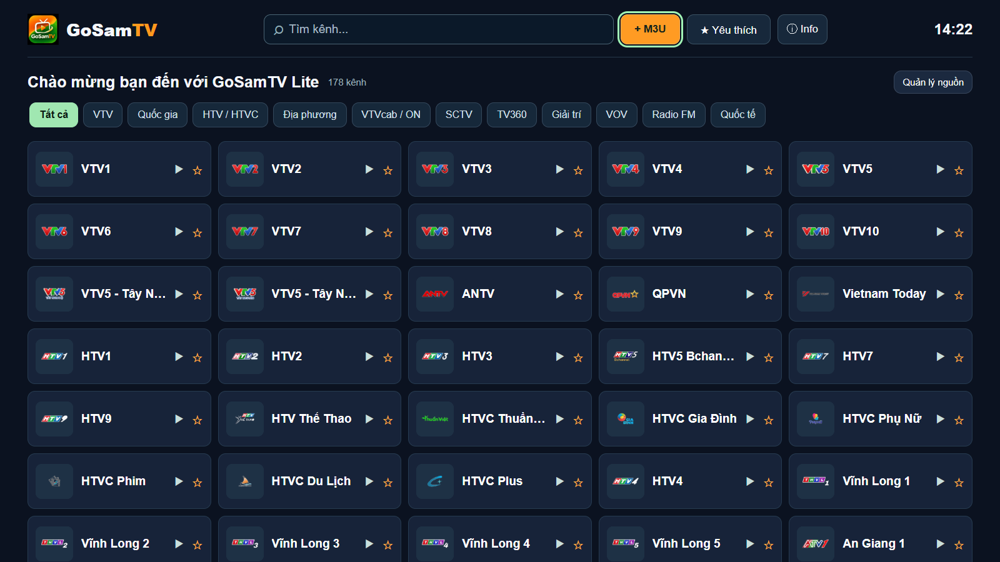
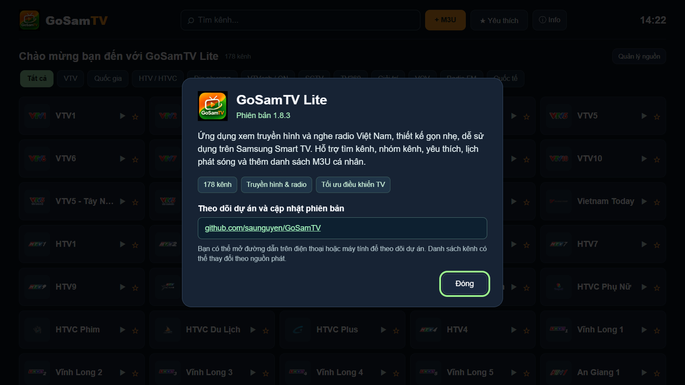
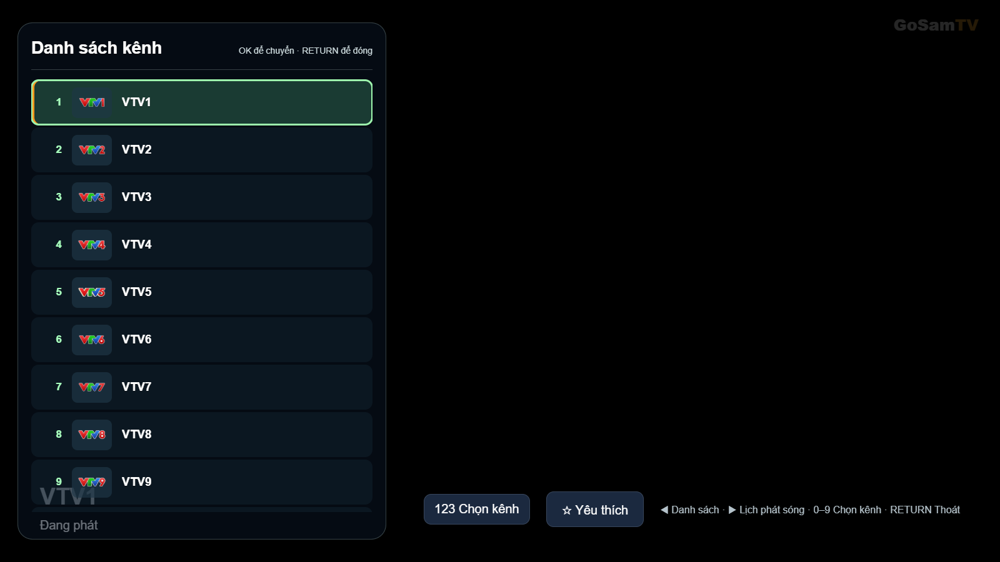
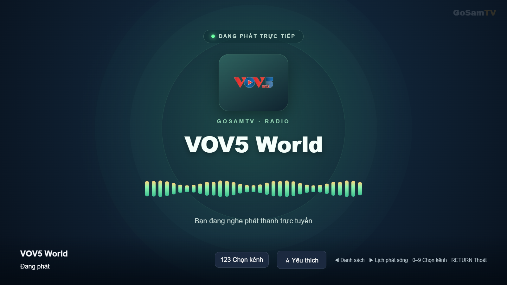
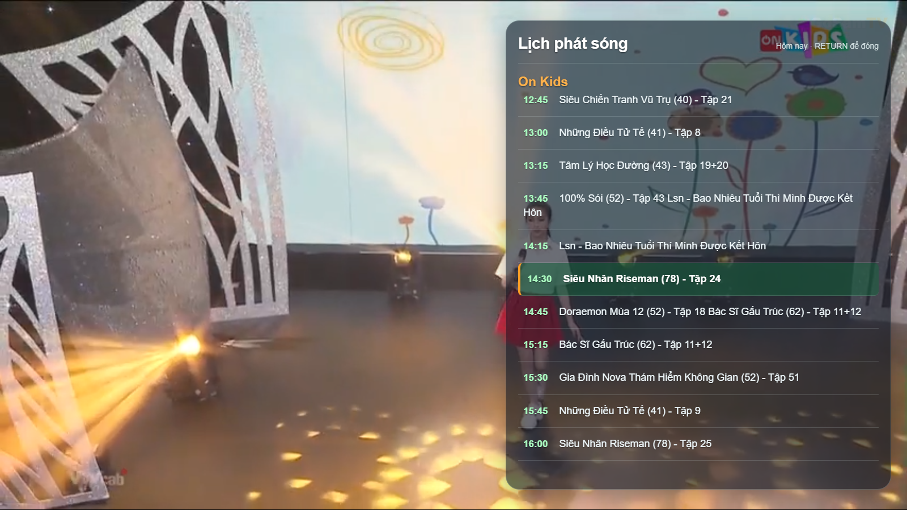
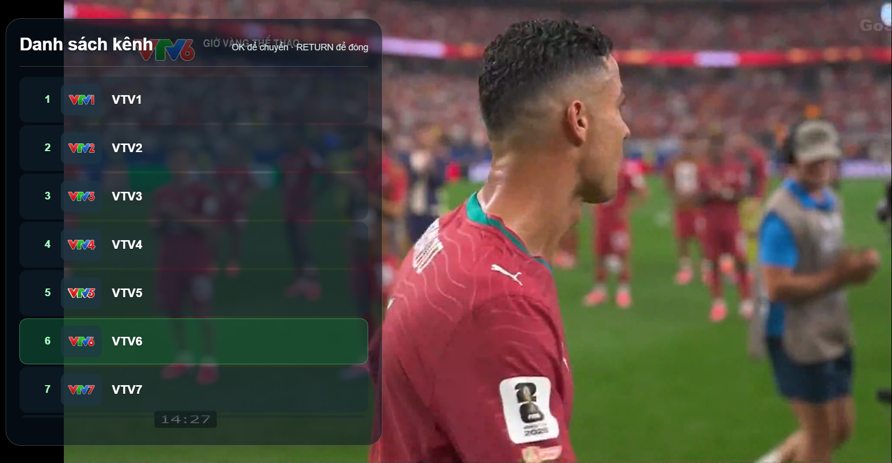

# GoSamTV Lite

**Truyền hình và radio Việt Nam trên Samsung Smart TV — gọn nhẹ, dễ sử dụng bằng điều khiển từ xa.**

**Phiên bản 1.8.3** · **178 kênh** · **Samsung Tizen**

## Giới thiệu

GoSamTV Lite là ứng dụng xem truyền hình và nghe radio, tập trung vào trải nghiệm đơn giản trên TV Samsung. Ứng dụng mở vào màn hình danh sách kênh, cho phép tìm theo tên, duyệt nhóm và lưu kênh yêu thích mà không cần qua nhiều màn hình.

Danh mục mặc định có **178 kênh (147 truyền hình, 31 radio)** đã từng phát được trong quá trình kiểm tra trên Chrome. Khả năng phát trên TV phụ thuộc từng nguồn và kết nối mạng; không cam kết mọi nguồn luôn hoạt động.

## Xem trực tuyến trên Chrome

**[▶ Mở GoSamTV Lite 1.8.3 — xem online](https://saunguyen.github.io/GoSamTV/lite/)**

Mở liên kết bằng **Google Chrome, Microsoft Edge** hoặc trình duyệt có hỗ trợ phát HLS. Không cần tải hay cài WGT để xem trên máy tính.

- **Trang online:** https://saunguyen.github.io/GoSamTV/lite/
- **Xem trước trên máy tính đang lưu dự án:** `file:///S:/GoSamTV%20Lite/app/lite.html` — chỉ mở được trên máy có ổ `S:`, **không phải liên kết internet**.
- Nguồn phát có thể bị giới hạn theo trình duyệt, CORS hoặc chính sách bên cung cấp. Một số kênh hoạt động trên TV nhưng không phát trên Chrome, và ngược lại.

## Hình ảnh giao diện

Các ảnh giới thiệu được ghi lại từ **GoSamTV Lite 1.8.3**: ảnh giao diện kiểm thử trên Chrome và ảnh thực tế người dùng cung cấp (VTV6). Hiển thị trên Samsung TV có thể hơi khác.

**Trang chủ — 178 kênh**

**Giới thiệu ứng dụng và thông tin phiên bản**

**Danh sách kênh khi đang xem**

**Radio Việt Nam**

**Lịch phát sóng — ON Kids**

**Danh sách kênh — VTV6**

## Tính năng

- **Truyền hình và radio:** các nhóm VTV, HTV, VTVcab, SCTV, VOV và nhiều kênh địa phương, quốc tế.
- **Tìm kênh trực tiếp:** nhập tên có dấu hoặc không dấu, danh sách lọc tức thì; nút **Thoát** và phím **RETURN** hỗ trợ rời bàn phím tìm kiếm.
- **Chuyển kênh bằng số:** nhận phím số tương thích và có **bàn phím số 123 ngay trong ứng dụng** để dùng với phím hướng/OK của Samsung Smart Remote.
- **Danh sách kênh và lịch phát sóng:** mở nhanh khi đang xem; điều hướng bằng remote, không có thanh cuộn trắng lớn.
- **Kênh yêu thích, thêm danh sách M3U cá nhân** và lưu lựa chọn trên thiết bị.
- **Giao diện radio:** tên kênh, logo, hiệu ứng sóng nhẹ khi nguồn chỉ có âm thanh.
- **Xem toàn màn hình:** thanh thông tin tự ẩn khi phát, watermark GoSamTV nhỏ và mờ.
- **Thông tin ứng dụng:** nút ⓘ Info hiển thị phiên bản và liên kết theo dõi dự án.

## Tải và cài đặt

| Gói | Mục đích | Tải về |
|---|---|---|
| GoSamTV Lite **1.8.3** | Bản chính, nên thử trước | [GoSamTV-1.8.3.wgt](dist/GoSamTV-1.8.3.wgt) |
| GoSamTV Lite **1.8.3 compat** | Bản dự phòng khi TV báo lỗi cài đặt | [GoSamTV-1.8.3-compat.wgt](dist/GoSamTV-1.8.3-compat.wgt) |

Ứng dụng được đóng gói cho **Samsung Tizen TV** và cần phương thức cài WGT phù hợp (chẳng hạn Developer Mode và công cụ triển khai Tizen). Hai gói dùng chung định danh ứng dụng, **không cài đồng thời**. Nếu nâng cấp không thành công do chứng chỉ khác với bản đang cài, có thể cần gỡ phiên bản cũ.

**Lưu ý:** Hai gói đã được kiểm tra cấu trúc và chữ ký, nhưng **phiên bản 1.8.3 chưa được kiểm chứng trực tiếp trên Samsung CU8000**. Người dùng nên thử bản chính trước và phản hồi nếu phím số hoặc bàn phím tìm kiếm vẫn gặp vấn đề.

## Hướng dẫn điều khiển

| Thao tác | Cách sử dụng |
|---|---|
| Mở kênh | Chọn thẻ kênh rồi nhấn **OK** |
| Danh sách kênh / lịch | Trong khi xem, nhấn **◀ / ▶** |
| Chuyển kênh liền kề | Trong khi xem, nhấn **▲ / ▼** |
| Chuyển theo số | Nhấn **OK** để hiện thanh thông tin, nhấn **OK** lần nữa để mở **123 Chọn kênh**; nhập số bằng phím hướng và OK |
| Tìm kênh | Chọn **Tìm kênh...** trên Home, nhập tên; dùng **Thoát / RETURN** để rời ô nhập |
| Quay lại | **RETURN** |

Một số phím và bàn phím 123 của hệ điều hành Samsung có thể xử lý khác nhau theo mẫu TV; vì vậy GoSamTV Lite có bàn phím số tích hợp.

## Cấu trúc dự án

- **app/lite.html** — trang ứng dụng chính thức.
- **app/js/lite.js** — chức năng và điều khiển TV.
- **app/css/lite.css** — giao diện tối giản.
- **app/data/lite-default-channels.js** — danh mục kênh.
- **tools/build_wgt.py** — đóng gói WGT (cần chứng chỉ ký riêng của người build).
- **dist/** — các tệp WGT đã phát hành.

Có thể mở app/lite.html bằng Chrome để xem trước giao diện, nhưng kiểm tra phát video trên Chrome **không thay thế** việc kiểm tra trên Samsung Tizen.

## Thay đổi trong phiên bản 1.8.3

- Cải thiện tiếp nhận phím số từ Samsung Smart Remote khi TV hỗ trợ gửi sự kiện phím đến ứng dụng.
- Thêm bảng số **123 Chọn kênh** ngay trong GoSamTV Lite làm phương án dự phòng.
- Chọn số theo thứ tự **178 kênh của danh mục chính**, không bị thay đổi bởi bộ lọc tìm kiếm hay yêu thích.
- Bổ sung xử lý phím **RETURN / Cancel** và nút **Thoát** cho tìm kiếm trên TV Samsung.
- Giữ nguyên danh sách kênh, giao diện radio, OSD tự ẩn, watermark và chức năng Info.

## Theo dõi và phản hồi

Theo dõi dự án, báo lỗi hoặc đề xuất tính năng tại [GitHub GoSamTV](https://github.com/saunguyen/GoSamTV) và mục [Issues](https://github.com/saunguyen/GoSamTV/issues).

**Ghi chú nguồn phát:** GoSamTV Lite là giao diện phát nội dung từ các đường dẫn được cấu hình. Các nguồn phát và lịch chương trình thuộc về đơn vị cung cấp tương ứng; liên kết có thể thay đổi hoặc ngừng hoạt động. Chỉ thêm danh sách M3U mà bạn có quyền truy cập.
