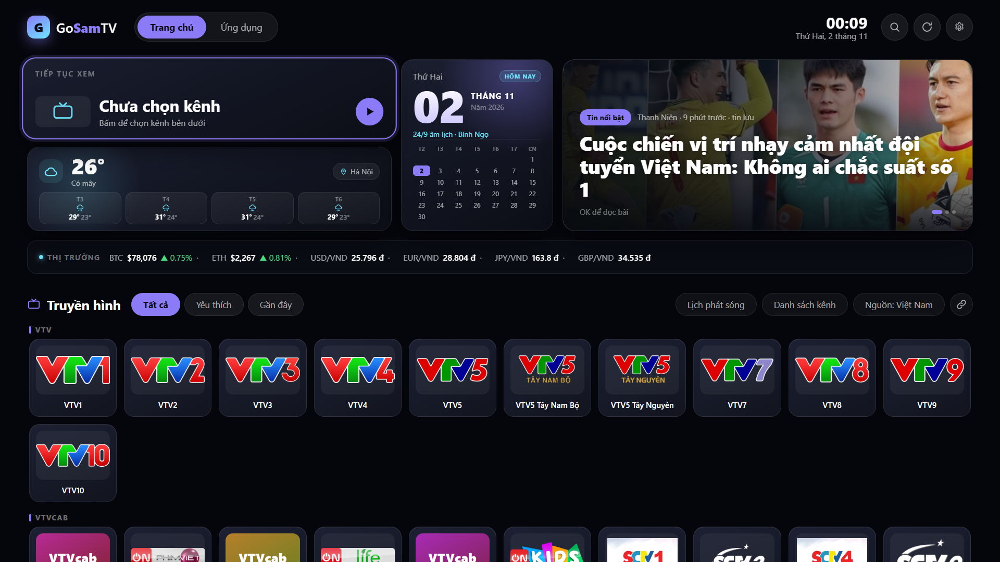

# GoSamTV — bản Samsung Tizen (`.wgt`)

Tệp cài đặt: **[dist/GoSamTV-1.5.1.wgt](dist/GoSamTV-1.5.1.wgt)** (~1,1 MB, đã ký số).

> Nếu TV từng báo lỗi `[118, -4] "operation not allowed"` khi cài bản 1.0.0: lỗi đó do gói cũ khai
> báo quyền cấp TV (`tv.inputdevice`) trong khi được ký bằng chứng chỉ Public. Bản 1.0.1 đã bỏ
> quyền đó và dùng đúng khuôn `config.xml` của các gói cài được trên TV Samsung.



## Vì sao phải dựng lại thay vì "chuyển đổi" từ APK

APK và WGT là hai nền tảng hoàn toàn khác nhau:

| | APK (bản gốc) | WGT (bản này) |
|---|---|---|
| Nền tảng | Android TV | Tizen (Samsung TV) |
| Chạy bằng | mã máy Dalvik/ART + Flutter engine | trình duyệt web của TV (HTML/CSS/JS) |
| Đóng gói | `classes.dex`, `lib/*/libapp.so` | `index.html`, `config.xml`, JS/CSS |

Mã trong APK là mã Flutter đã biên dịch cho ARM, không có bản mã nguồn trong repo (repo chỉ có
tài liệu, `us.m3u`, `rss.json`, `store.json` và script phát hành). Vì vậy không có công cụ nào
"chuyển" được APK sang WGT — cách duy nhất là **dựng lại giao diện và tính năng thành web app
Tizen**. Đó chính là nội dung thư mục này: một ứng dụng Tizen độc lập, giao diện bám theo ảnh
chụp trong `screenshots/`, dùng đúng dữ liệu của repo (`us.m3u`, `rss.json`).

## Bản này có gì

- **Trang chủ một màn hình**: tiếp tục xem, ngày âm lịch (tính bằng thuật toán lịch Việt Nam),
  thời tiết 4 ngày, tin nổi bật, bảng giá thị trường (BTC/ETH, USD/EUR/JPY/GBP → VND).
- **Truyền hình**: 122 kênh Việt Nam (VTV, HTV, Vĩnh Long, các đài tỉnh…) và 1.127 kênh quốc tế
  lấy từ `us.m3u`; kênh được **gom thành từng hàng theo `group-title`** (VTV, VTVcab, HTV, THVL,
  Miền Bắc/Trung/Nam, Tin tức…); mỗi nhóm xếp thành **lưới nhiều dòng** (10 kênh/hàng, thẻ 168×152) nên không kênh nào bị cắt ở mép phải; lọc Tất cả / Yêu thích / Gần đây; phát HLS toàn màn hình.
  Mục Truyền hình nằm ngay màn hình đầu, có hai nút **Lịch phát sóng** và **Danh sách kênh**.
- **Lịch phát sóng (EPG)**: lịch của 83 kênh Việt Nam (nguồn VNEPG), chương trình đang phát được tô
  sáng và tự cuộn tới; **xem được ngày trước / ngày sau** bằng hàng nút *‹ Ngày trước · Hôm nay ·
  Ngày sau ›* (ấn ▲ từ cột kênh để lên hàng nút, ◀▶ chọn nút, OK); thanh OSD hiện "Đang phát" và
  "Tiếp theo".
- **Danh sách kênh**: toàn bộ kênh của nguồn đang chọn, chia nhóm có tiêu đề (VTV · 12, VTVcab · 11, ...), chọn là phát luôn.
- **Yêu thích**: nhóm **★ Yêu thích** nằm trên cùng danh sách kênh (cả bảng chọn kênh khi đang xem
  lẫn màn hình Danh sách kênh). Bật nút **☆ Sửa yêu thích** rồi bấm OK trên kênh để thêm/bỏ dấu ★.
- **Nút quay lại ↰** ở góc phải mỗi bảng, bấm được bằng remote — thay cho việc phải nhớ phím RETURN.
- **Nguồn kênh**: nút **Nguồn: …** mở bảng chọn *Việt Nam / Quốc tế / M3U của tôi* kèm số kênh và
  dấu "đang dùng". Lựa chọn được lưu lại; bản này tự đưa về danh sách Việt Nam nếu lần trước bị kẹt ở
  danh sách Quốc tế do nút cũ (bấm là chuyển nguồn) gây nhầm.
- **Tin tức**: đọc RSS ngay trên TV, có ảnh, nguồn, thời gian; **thẻ Tin nổi bật xoay vòng 3 tin**
  (12 giây/tin). Bốn nguồn mặc định: VnExpress, Tuổi Trẻ, Thanh Niên, BBC Việt; thêm/xoá nguồn RSS
  trong Cài đặt. Bản tin **được nhúng sẵn vào gói** dưới dạng script (`app/data/news.js`, làm mới mỗi lần build — không cần fetch/CORS nên chạy trên mọi đời Tizen) nên
  trang chủ luôn có tin kể cả khi TV không gọi được RSS (CORS) hay proxy bị giới hạn 429; khi tải live
  được thì tin mới thay thế.
- **Thời tiết**: Open-Meteo, 6 thành phố, không cần API key. Thẻ thời tiết có icon trong ô, tên thành phố dạng nhãn ghim, và dự báo 4 ngày kèm icon thời tiết từng ngày.
- **Tìm kiếm kênh**: nút kính lúp trên thanh trên cùng → gõ tên bằng bàn phím ảo của TV, kết quả lọc ngay (không phân biệt hoa/thường và **không cần dấu**: "vinh long" khớp "Vĩnh Long"), tìm cả theo nhóm kênh; OK để xem kênh, RETURN để đóng.
- **Trạng thái kết nối**: 3 chip **Wi-Fi / Cáp / Bluetooth** trên thanh trên cùng, sáng lên khi đang dùng; bấm vào để xem loại mạng, IP, tên Wi-Fi (SSID) và trạng thái Bluetooth. Cần quyền `network.get` và `bluetooth` (đều mức Public). Khi mở thử trên máy tính, các chip vẫn hiện nhưng ở trạng thái ước lượng (có ghi chú "xem trước" trong bảng Kết nối).
- **Ứng dụng TV**: liệt kê ứng dụng đã cài trên chính chiếc TV (YouTube, Netflix…) và mở thẳng bằng `tizen.application.launch` — không cần thoát GoSamTV.
- **Cài đặt**: thành phố, màu nhấn, bật/tắt từng khối, đổi nguồn kênh, nhập link M3U riêng.
- **Điều khiển bằng remote**: mũi tên di chuyển, OK chọn, RETURN quay lại/thoát.
- **Đang xem truyền hình**: **◀ mở danh sách kênh dạng lưới ô vuông** (7 kênh/hàng, chia nhóm
  VTV, VTVcab, HTV, Vĩnh Long, Miền Bắc/Trung/Nam, Tin tức…; ◀▲▼▶ di chuyển, OK xem kênh, RETURN đóng).
- **▶ mở lịch phát sóng của kênh đang xem**: ▲▼ chọn kênh bên trái, **▶ nhảy vào danh sách chương
  trình** (▲▼ cuộn từng chương trình, ◀ quay lại cột kênh), **▲ lên hàng nút để đổi ngày** (‹ Ngày
  trước · Hôm nay · Ngày sau ›), **OK** chuyển sang kênh đang chọn, **RETURN** đóng bảng.
- Khi không mở bảng: **▲▼ tăng/giảm kênh**, **OK** ẩn/hiện thanh thông tin, **RETURN** thoát về trang chủ.

## Danh sách kênh đã được lọc (dò luồng thật)

Danh sách gốc trong repo có rất nhiều link đã chết, nên app chỉ ship những kênh **kiểm tra được là
còn phát**:

| Nguồn | Trước | Sau khi lọc | Ghi chú |
|---|---|---|---|
| Việt Nam (truyền hình) | 122 | **91** | tất cả đều dò được luồng thật; 18 kênh được thay link mới |
| Việt Nam (radio) | 11 | **10** | VOV1–VOV5, VOV Giao Thông HN/TP.HCM, Hà Nội FM 90, Hải Phòng FM, XONE Radio, RFI Tiếng Việt |
| Quốc tế (`us.m3u`) | 1.127 | **509** | Phần lớn link cũ đã chết hoặc chặn IP |

Radio nằm trong nhóm **RADIO** của mục Truyền hình. Khi phát, app hiện màn hình riêng (logo đài,
tên đài, hiệu ứng sóng) thay vì khung hình đen, vì các đài này chỉ có tiếng.

**17 kênh Việt Nam đã thay link mới** (`tools\vn-overrides.json`):

- **Nhóm HTV/HTVC (10 kênh)** lấy từ [khanh71/All-In-One-IPTV](https://raw.githubusercontent.com/khanh71/All-In-One-IPTV/main/http-iptv.m3u)
  (CDN `vnns.net`): HTV1, HTV2, HTV3, HTV7, HTV9, HTV Thể Thao, HTVC Gia Đình, HTVC Phim,
  HTVC Phụ Nữ, HTVC Plus.
- Hà Nội 1, Tây Ninh, An Ninh TV, An Giang 2, Quảng Ninh 3, VTVcab 2 Phim Việt (luồng ON Phim Việt).

**31 kênh còn lại chưa có luồng** — chủ yếu là đài tỉnh đã sáp nhập (Hà Nội 2, Hà Tĩnh, Đồng Nai 2,
Thừa Thiên Huế, Đắk Lắk, Khánh Hòa, Thanh Hóa, Bình Phước, Hậu Giang, Bình Định, Bà Rịa – Vũng Tàu,
Yên Bái, Nhân Dân, VNews), thêm SCTV1.

Muốn bổ sung: dán link `.m3u8` mới vào `tools\vn-overrides.json` theo mẫu
`{"<id kênh>": {"url": "https://...", "org": "nguồn"}}` rồi chạy lại `prepare_assets.py` + build.

Cách hoạt động:

1. `python tools\probe_streams.py` — tải manifest của từng kênh quốc tế; nếu là master playlist thì
   tải thêm biến thể đầu tiên để chắc có segment. Kết quả: `.work\stream-test.json`.
2. `python tools\probe_vn.py` — làm tương tự với 122 kênh Việt Nam → `.work\stream-test-vn.json`.
3. `python tools\merge_status.py` — gộp thành `tools\stream-status.json`.
4. `python tools\prepare_assets.py` — bỏ các kênh không đạt, sinh lại `app\data\channels.js`.

Muốn dò lại (link IPTV thay đổi liên tục), chạy lại 4 bước trên rồi build. Lưu ý: phép dò chỉ xác
nhận **tải được manifest + segment**; vẫn có thể lỗi codec/DRM hoặc chặn theo vùng khi phát trên TV.

## Kênh và lịch: app đọc gì từ tài liệu repo

Theo `docs/content-guide.vi.md`, một danh sách kênh chỉ là **playlist M3U thuần**:

```m3u
#EXTM3U
#EXTINF:-1 tvg-id="VTV1.vn" tvg-logo="https://example.com/vtv1.png" group-title="VTV",VTV1
https://example.com/vtv1/index.m3u8
```

- `tvg-id` — dùng để khớp kênh với lịch phát sóng
- `tvg-logo` — logo (không bắt buộc)
- `group-title` — gom kênh thành từng hàng (không bắt buộc)
- chữ sau dấu phẩy là tên hiển thị; dòng kế tiếp là URL stream

App bám đúng mô hình đó: kênh đọc từ M3U, gom hàng theo `group-title`, và nếu playlist khai báo
lịch bằng `x-tvg-url` trên dòng `#EXTM3U` thì app tải file **XMLTV** đó (kể cả `.gz`) và khớp
theo `tvg-id`.

Riêng file `us.m3u` của repo khai báo:

```
#EXTM3U x-tvg-url="https://raw.githubusercontent.com/StrangeDrVN/epg/public/guide.xml.gz"
```

Kiểm tra ngày 01/11/2026: file guide đó có 505 kênh / 34.599 chương trình nhưng **chỉ phủ
13–16/10/2026** (đã cũ, 0 chương trình cho hôm nay) và **không có `tvg-id` nào trùng với `us.m3u`**
(id trong guide kiểu `4TVNews.in@SD`, trong playlist kiểu `ABC.us@East`). Vì vậy nguồn đó không
dùng được — lịch của các kênh Việt Nam lấy từ VNEPG (83 kênh, cập nhật hằng ngày), còn playlist bạn
tự nhập mà có `x-tvg-url` chạy được thì app sẽ đọc lịch từ đó.

## Cài lên TV Samsung

### Cách 1 — dùng Apps2Samsung (đã có trên máy này)

1. Mở Apps2Samsung, chọn chức năng cài từ tệp (hoặc kéo–thả) rồi trỏ tới
   `dist\GoSamTV-1.5.1.wgt`.
2. Nhập IP TV nếu ứng dụng hỏi, rồi bấm cài. TV và máy tính phải cùng mạng Wi-Fi/LAN.

> Apps2Samsung **ký lại** gói bằng chứng chỉ của nó trước khi cài, nên chữ ký trong tệp không
> quyết định kết quả. Nếu TV vẫn từ chối, vấn đề nằm ở `config.xml` — xem ghi chú ở đầu tài liệu.

### Cách 2 — sdb (Tizen Studio)

1. Trên TV: **Apps** → nhập `12345` bằng remote → bật **Developer mode**, nhập IP máy tính →
   khởi động lại TV.
2. Trên máy tính (đã cài Tizen Studio, có `sdb` trong `tizen-studio\tools`):

```powershell
sdb connect <IP-TV>:26101
sdb install "S:\GoSamTV\dist\GoSamTV-1.5.1.wgt"
```

3. Ứng dụng **GoSamTV** sẽ xuất hiện trong danh sách Apps của TV.

## Xem thử trên máy tính

Mở `app\index.html` bằng Chrome/Edge (hoặc chạy `preview.bat`). Giao diện và dữ liệu giống hệt
trên TV; phần "Ứng dụng" và phím remote chỉ hoạt động thật trên TV.

## Tùy chỉnh và build lại

```powershell
# 1. Sinh dữ liệu kênh + logo + bản đồ EPG (cần Python có Pillow)
& 'C:\Users\saunv\.dsh\dsh-runtimes\dsh-primary-runtime\dependencies\python\python.exe' tools\prepare_assets.py

# 2. Đóng gói và ký (cần Python có cryptography + lxml)
python tools\build_wgt.py            # bản chính -> dist\GoSamTV-<version>.wgt
python tools\build_wgt.py compat     # config tối giản (dự phòng khi TV không nhận bản chính)
```

- **Danh sách kênh**: sửa `us.m3u` (kênh quốc tế) hoặc trỏ `tools/prepare_assets.py` tới danh sách
  kênh Việt Nam, rồi chạy lại bước 1.
- **Lịch phát sóng**: bản đồ kênh → mã EPG nằm ở `app/data/epg-map.js` (sinh từ
  `S:\TV & Radio Viet\web\epg-channel-map.json`); API là `https://lichphatsong.io.vn/api/v1/guide`.
- **Tin tức mặc định**: `DEFAULT_FEEDS` trong `app/js/app.js`.
- **Version / tên ứng dụng**: `VERSION` và `CONFIG_MAIN` trong `tools/build_wgt.py`.
- **Chứng chỉ ký**: `CERT_ROOT` trong `tools/build_wgt.py`.

## Cấu trúc

```
app/                     nguồn web app (mở trực tiếp bằng trình duyệt để xem thử)
  index.html
  css/app.css
  js/app.js              toàn bộ logic: focus engine, kênh, EPG, tin, thời tiết, cài đặt
  data/channels.js       dữ liệu kênh (sinh tự động)
  data/epg-map.js        bản đồ kênh -> mã EPG (sinh tự động)
  img/logos/             logo kênh đã nén (sinh tự động)
  img/icon.png           icon ứng dụng
tools/prepare_assets.py  sinh channels.js, epg-map.js và logo
tools/wgtsign.py         ký/kiểm tra chữ ký WGT theo chuẩn Tizen
tools/build_wgt.py       đóng gói + ký + tự kiểm tra
build/                   bản staging được đóng gói
dist/                    thành phẩm .wgt
```

## Điểm cần biết

- **Mã 6 ký tự** của bản Android không dùng được: mã đó do máy chủ `tv.launchpad2.app` phân giải,
  không có API công khai. Bản Tizen thay bằng "Nhập M3U" (dán link playlist) và quản lý RSS trực tiếp.
- **Kênh hỏng**: danh sách kênh là link công khai, nhiều kênh trong `us.m3u` đã chết hoặc chặn IP —
  bản Android cũng gặp đúng những kênh đó. Danh sách Việt Nam (122 kênh) ổn định hơn.
- **TV cần Internet** cho thời tiết, bảng giá, tin tức, EPG và để phát kênh.
- **Chưa có**: tìm kiếm bằng giọng nói, mã 6 ký tự, xổ số XSMB.

## Chữ ký số

WGT được ký theo đúng định dạng của Tizen (W3C widget signature): `author-signature.xml` (SHA-512
từng tệp, RSA-SHA512, exc-c14n) và `signature1.xml` (bọc thêm `author-signature.xml`).
`tools/wgtsign.py` có hàm `verify_wgt()` để kiểm tra lại bất kỳ file `.wgt` nào:

```powershell
python tools\check_wgt.py dist\GoSamTV-1.5.1.wgt
```
