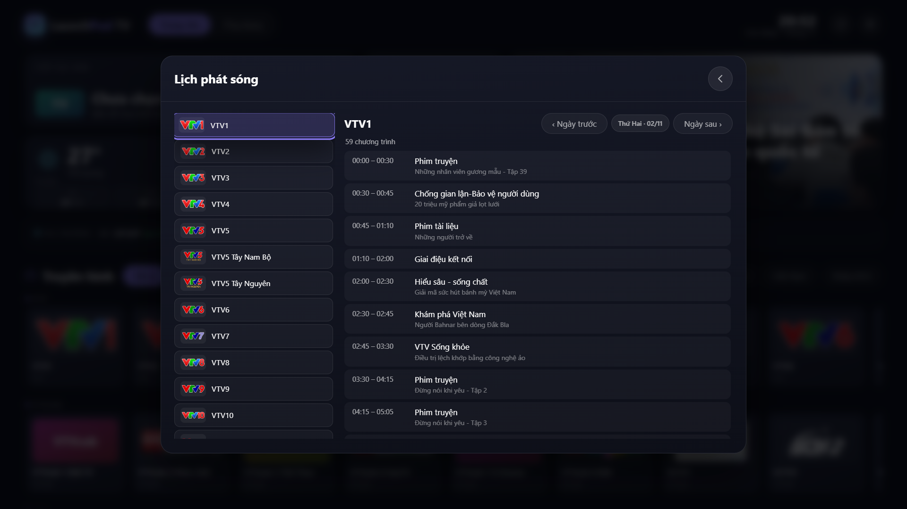
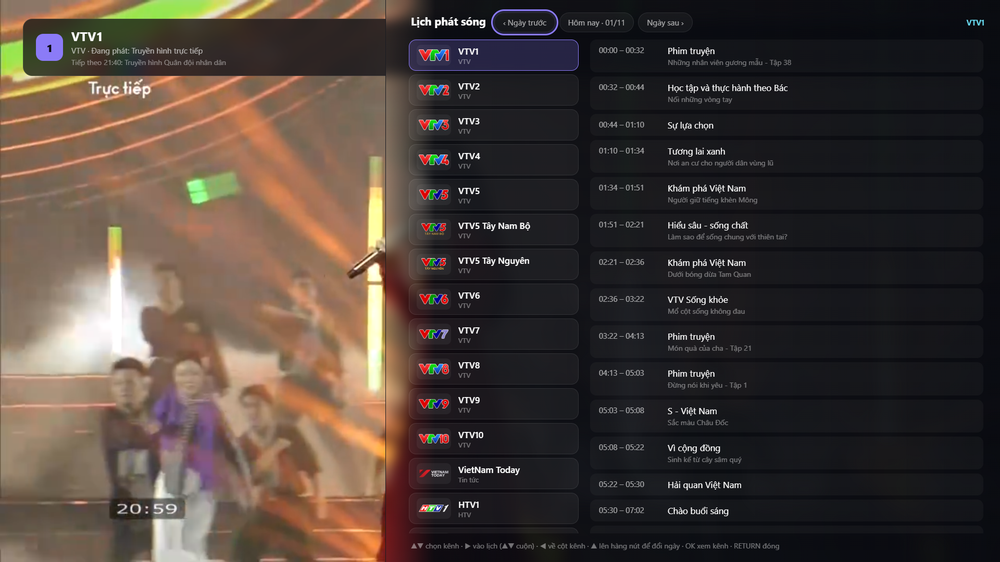

# GoSamTV: tự làm app xem truyền hình cho Smart TV Samsung

> Từ một APK Android TV không chạy được trên Tizen, đến một trang chủ xem kênh, lịch phát sóng và radio
> chạy được trên chiếc TV Samsung ở nhà — vài ghi chép về những gì đã làm và những cái bẫy gặp phải.

## Vì sao

Chiếc TV trong nhà là Samsung UA55CU8000KXXV chạy Tizen. Mình có sẵn một APK của LaunchPad TV
(một trang chủ đẹp cho Android TV), nhưng Tizen không cài được APK — hai nền tảng khác hẳn nhau về
kiến trúc. Cách duy nhất để "mang giao diện đó về" là dựng lại nó bằng web app rồi đóng gói thành
`.wgt`.

Thế là GoSamTV ra đời: cùng tinh thần "bật TV lên là mọi thứ đã ở đó", nhưng viết lại cho Tizen.

## Kết quả

- **100 kênh Việt Nam** (90 truyền hình + 10 radio) và **509 kênh quốc tế** — tất cả đều đã dò luồng thật,
  không có kênh chết trong danh sách.
- **Lịch phát sóng** theo kênh và theo ngày.
- **Tìm kiếm** bằng bàn phím ảo của TV, gõ không cần dấu.
- **Yêu thích**, **radio** có màn hình phát riêng, **tin tức** RSS, **thời tiết**, **giá thị trường**,
  **lịch âm** và mở nhanh các **ứng dụng khác trên TV**.
- Điều khiển **hoàn toàn bằng remote**, không cần chuột, không cần bàn phím.

## Bốn bài học lớn

### 1. Tizen không giống trình duyệt

Lần đầu cài, TV báo `[118, -4] operation not allowed`. Lý do: gói khai báo quyền
`http://tizen.org/privilege/tv.inputdevice` — quyền mức Partner, mà mình chỉ ký được bằng chứng chỉ mức
Public, nên TV từ chối ngay từ bước đọc thông tin gói.

Bài học: **càng ít quyền càng dễ cài**. Bỏ quyền đó, dùng chứng chỉ Public, khai báo
`tizen:allow-navigation href="*"` và profile `tv-samsung` là cài được. Điều khiển bằng remote thì vẫn
hoạt động với các phím mũi tên / OK / RETURN — chính là những phím mà app thực sự cần.

Hệ quả kéo theo: phím CH+/CH− (mã 427/428) **không** đến được app nếu thiếu quyền thiết bị vào.
Nên việc chuyển ngày trong lịch phát sóng phải làm bằng nút trên màn hình thay vì phím cứng.

### 2. Danh sách kênh công khai chết rất nhanh

Danh sách gốc có 122 kênh Việt Nam và 1.127 kênh quốc tế. Mình viết script tải manifest của từng kênh,
yêu cầu HTTP 200 + `#EXTM3U`; nếu là master playlist thì tải tiếp biến thể đầu tiên để chắc chắn có
segment.

Kết quả: quốc tế chỉ còn **509/1.127** kênh sống. Việt Nam còn 90/122.

Với 32 kênh Việt Nam đã chết, mình đi tìm link thay thế từ các danh sách cộng đồng và dò lại từng cái:

- **Nhóm HTV/HTVC**: tìm được một CDN công khai còn phát — lấy lại được 10 kênh (HTV1, HTV2, HTV3,
  HTV7, HTV9, HTV Thể Thao, HTVC Gia Đình, HTVC Phim, HTVC Phụ Nữ, HTVC Plus).
- **6 kênh khác** thay được link (Hà Nội 1, Tây Ninh, An Ninh TV, An Giang 2, Quảng Ninh 3, VTVcab 2).
- **32 kênh còn lại** không có luồng công khai: HTV4, SCTV1 (chặn vùng/DRM) và phần lớn là đài tỉnh đã sáp nhập
  nên giờ chỉ tiếp sóng đài tỉnh mới.

Tất cả những thay thế này nằm trong một file `vn-overrides.json` nhỏ, để lần sau chỉ cần thêm một dòng
là có kênh mới.

### 3. Tin tức trên TV khó hơn tưởng tượng

Trình duyệt trên TV chặn CORS khi gọi thẳng RSS. Giải pháp quen thuộc là dùng một dịch vụ proxy
RSS→JSON, nhưng dịch vụ đó giới hạn theo IP và rất nhanh trả **429 Too Many Requests** — trang chủ
trắng trơn.

Cách giải quyết cuối cùng: **nhúng sẵn một bản tin vào gói cài**. Mỗi lần build, script Python tải tin
mới nhất từ 4 nguồn (VnExpress, Tuổi Trẻ, Thanh Niên, BBC Việt) và ghi thành một file JS nhỏ
(`data/news.js`) — nạp bằng thẻ `<script>` nên không cần fetch, không cần CORS, chạy trên mọi đời Tizen.
Khi TV gọi được RSS thì tin mới thay thế; khi không, người dùng vẫn thấy tin (có ghi "tin lưu").

### 4. Lịch phát sóng — phần khó nhất

Nếu kênh chỉ là "tải M3U rồi phát", thì **lịch phát sóng (EPG)** mới là phần ngốn thời gian nhất. Kênh
nào cũng có tên riêng, giờ riêng, và mỗi nguồn lịch lại đánh mã kênh theo một kiểu khác nhau.

**Nguồn đầu tiên không dùng được.** Playlist gốc có khai báo một file XMLTV (`guide.xml.gz`) với hơn 500
kênh — nghe rất hứa hẹn. Nhưng mở ra thì:

- Dữ liệu chỉ có từ **13 đến 16/10/2026**, đã cũ.
- Mã kênh kiểu `4TVNews.in@SD`, `ABC.us@East` — trong khi app dùng `vtv1`, `htv7`, `thvl1`… **không khớp
  một dòng nào**.

Nói cách khác: tải được file, đọc được XML, nhưng không nối được chương trình nào vào kênh nào.

**Nguồn thay thế: API VNEPG.** Mình chuyển sang `https://lichphatsong.io.vn/api/v1/guide?channel=<id>` —
trả JSON theo từng kênh, có dữ liệu vài ngày tới, lại mở CORS nên gọi thẳng từ TV được. Vấn đề còn lại
là **mã kênh bên đó là `vtv1hd`, `vtv2hd`, `htv7hd`…**, khác mã nội bộ của app.

Cách giải: một bảng ánh xạ nhỏ `app/data/epg-map.js` (83 kênh), dạng:

```js
window.LP_EPG = { "vtv1": "vtv1hd", "vtv2": "vtv2hd", "htv7": "htv7hd", ... };
```

Kênh nào không có trong bảng thì app **không hiện nút lịch** thay vì mở một bảng trống — người dùng
không phải đoán "sao bấm vào không có gì".



**Chuyển ngày lại là một cái bẫy khác.** Ban đầu mình cho CH+/CH− đổi ngày, nhưng đúng như bài học số 1:
thiếu quyền thiết bị vào thì hai phím đó **không bao giờ đến được app**. Nên phải làm ba nút bấm được
ngay trên đầu bảng:

> `‹ Ngày trước` · `Hôm nay · 01/11` · `Ngày sau ›`

Và vì mỗi kênh chỉ có lịch trong một khoảng ngày nhất định, app tính `min`/`max` của dữ liệu rồi kẹp
nút lại — bấm mãi cũng không rơi vào ngày trống. Từ cột kênh, bấm ▲ là lên hàng nút này.

**Hiển thị ở hai nơi, cùng một dữ liệu:**

- Ở trang chủ: nút "Lịch phát sóng" mở bảng đầy đủ — cột kênh bên trái, danh sách chương trình bên phải.
- Khi đang xem kênh: bấm ▶ mở đúng bảng đó dạng tấm trượt bên phải, kênh đang xem được chọn sẵn. Chương
  trình **đang phát** được tô sáng theo đồng hồ thực.



Thêm hai chi tiết nhỏ nhưng đáng giá:

- **Thanh thông tin (OSD)** khi chuyển kênh hiện luôn *"Đang phát: …"* và *"Tiếp theo HH:MM: …"*, nên
  không cần mở bảng vẫn biết đang xem gì.
- **Radio không có lịch** — thay vì để bảng trắng, app báo rõ: *"Đài radio không có lịch phát sóng.
  Dùng ◀ để mở danh sách kênh."*

Và một lỗi thật đã gặp: đoạn xử lý radio còn trỏ tới phần tử `#epg-day` — phần tử này đã bị thay bằng
hàng nút ngày từ trước. Kết quả: bấm ▶ trên đài radio thì bảng **đứng nguyên ở "Đang tải lịch phát
sóng…"** mãi mãi, vì câu lệnh đầu tiên trong callback đã ném lỗi và dừng cả phần còn lại. Bài học:
khi đổi cấu trúc DOM, phải rà lại mọi chỗ còn gọi tên cũ — và luôn kiểm tra phần tử có tồn tại trước
khi gán.

## Vài chi tiết nhỏ nhưng tốn thời gian

- **Lịch âm**: `Intl` với lịch Trung Quốc không có trên Tizen, nên phải cài thuật toán lịch Việt Nam
  (Hồ Ngọc Đức) và kiểm tra lại các ngày Tết 2023–2026, kể cả tháng nhuận 2025.
- **EPG**: nguồn XMLTV đi kèm repo đã cũ và id không khớp; phải chuyển sang API VNEPG cho kênh Việt Nam.
- **Chữ ký gói**: `.wgt` cần hai chữ ký (author + distributor), mỗi file có digest SHA-512 và tham chiếu
  URI mã hoá phần trăm. Viết lại bằng Python và đối chiếu với 3 gói thật để chắc chắn đúng chuẩn.
- **Bố cục**: TV 4K báo 1920×1080 CSS px, nên toàn bộ giao diện thiết kế cố định theo khung đó; mọi thứ
  phải vừa một màn hình, điều khiển bằng 4 phím mũi tên.

## Dùng thử

Mã nguồn, bộ script dò luồng và gói cài đặt nằm trong repo này. Bản web chạy thử: **https://saunguyen.github.io/GoSamTV/** (trình duyệt thiếu HLS sẽ tự nạp `hls.js`). Gói `dist/GoSamTV-1.7.3.wgt` đã ký sẵn,
cài bằng Apps2Samsung hoặc Tizen Studio — hướng dẫn chi tiết trong [TIZEN.vi.md](../TIZEN.vi.md).

Nếu bạn cũng có một chiếc TV Samsung và một danh sách kênh yêu thích, cứ fork rồi thay
`tools/vn-overrides.json` bằng link của bạn.

---

*GoSamTV là dự án cá nhân, không liên kết với Samsung hay bất kỳ đài truyền hình nào. Ứng dụng không lưu
trữ nội dung; nó chỉ tổng hợp các luồng HLS công khai do bên thứ ba công bố.*
