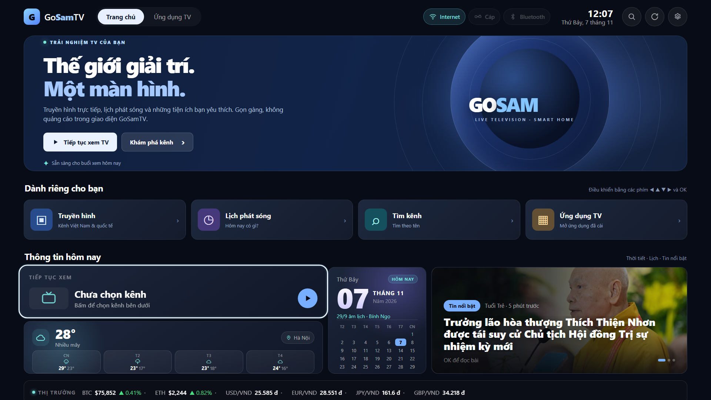

# GoSamTV 1.7.9: tự làm giao diện truyền hình cho Samsung Tizen

*Ghi chép thực tế từ Samsung CU8000 55 inch: từ một ý tưởng thay giao diện Home đến một ứng dụng phát truyền hình có hình, tiếng và điều khiển bằng remote.*

## Tại sao lại làm GoSamTV?

Màn hình Home mặc định của Samsung có nhiều mục đề xuất và không cho tùy biến hoàn toàn theo ý mình. Trong khi đó, Samsung chạy Tizen nên không thể cài trực tiếp APK Android TV. Vì vậy mình xây dựng một ứng dụng web Tizen riêng, đóng gói thành file `.wgt`, để mở nhanh các kênh và tiện ích quen thuộc.

GoSamTV **không thay thế firmware hay Smart Hub**. Nó là một ứng dụng có giao diện trang chủ riêng, mở từ danh sách ứng dụng của TV.

## Home 2.0: đẹp nhưng phải dễ điều khiển

Phiên bản mới thiết kế theo tinh thần Google TV: nền xanh đen, banner lớn, các lối tắt Truyền hình, Lịch phát sóng, Tìm kênh, Ứng dụng TV; bên dưới là thời tiết, lịch, tin tức và danh sách kênh. Bố cục ưu tiên màn hình 16:9 và phím mũi tên/OK/RETURN, không yêu cầu chuột.

Logo GoSamTV cũng đã đổi sang **cam – xanh lá cây**, dễ nhận ra hơn trong danh sách ứng dụng.

## Từ “cài mãi không xong” đến “có tiếng, có hình”

Đây là phần mất thời gian nhất khi thử trên **Samsung UA55CU8000KXXV (Tizen 9.0)**.

Ban đầu, công cụ cài đặt có lần dừng ở 10%. Thử chỉ chuyển file qua SDB không đủ để kết luận đã cài: phải đọc nhật ký tới dòng **`install completed`**. Sau khi xử lý quy trình qua Apps2Samsung, các bản mới cài thành công trong vài giây.

Lỗi tiếp theo khó chịu hơn: **chọn kênh nghe được tiếng nhưng không thấy hình**. Trên Tizen, Samsung AVPlay có thể phát trên một mặt phẳng video riêng, nằm *bên dưới* WebView. Khi nền trình duyệt hoặc khung phát vẫn đen, nó che luôn phần hình mà vẫn nghe tiếng bình thường.

Cách sửa trong GoSamTV:
- Bổ sung phần tử native `application/avplayer` trong giao diện.
- Chuyển nền WebView và vùng phát thành trong suốt khi AVPlay hoạt động; khôi phục khi thoát.
- Đặt lại vùng hiển thị 1920×1080 sau `prepareAsync` và duy trì lớp OSD bên trên.
- Có cơ chế thử kết nối lại, thông báo trạng thái phát và đường phát HTML5 cho trình duyệt.

**Bản 1.7.8 đã được xác nhận phát được hình và tiếng trên TV thử nghiệm. Bản 1.7.9 giữ cơ chế đó và cập nhật logo.** Đây là kết quả thử trên thiết bị thực tế, không phải lời hứa tương thích mọi dòng Samsung hay mọi luồng IPTV.

## Tính năng chính

- **101 kênh Việt Nam** trong dữ liệu đóng gói (91 truyền hình, 10 radio) cùng danh sách quốc tế, có phân nhóm và tìm kiếm không dấu.
- **Lịch phát sóng (EPG)** theo kênh và ngày; khi đang xem có thể mở lịch bằng phím ▶.
- **Yêu thích** và lịch sử kênh đã xem, giúp tiếp tục xem nhanh.
- **Radio**, thời tiết, lịch âm, tin tức RSS với bản tin lưu sẵn, và thông tin thị trường.
- **Danh sách ứng dụng trên TV** và phím tắt, tùy theo khả năng API của thiết bị.
- **Chrome trên máy tính:** xem trước giao diện trước khi đóng gói WGT; một số chức năng chỉ hoạt động trên TV.

## Những bài học rút ra

**Tizen không phải Android.** Nên thiết kế gói phù hợp profile `tv-samsung`, dùng đúng quyền hệ thống và thử trên TV thực.

**Không phải link M3U nào cũng phát mãi.** Dữ liệu kênh được kiểm tra lúc chuẩn bị, nhưng nguồn bên thứ ba có thể thay đổi, hết hạn hoặc hạn chế khu vực.

**Tin RSS có thể bị CORS.** GoSamTV kèm dữ liệu tin tức nhúng để giao diện vẫn có nội dung khi không tải được RSS trực tiếp.

**Cài đặt hoàn tất khác với chuyển file hoàn tất.** Kiểm tra nhật ký Apps2Samsung để xác nhận cài đặt thay vì chỉ nhìn SDB trả exit 0.

**Hình và tiếng là hai đường xử lý khác nhau.** AVPlay có thể giải mã âm thanh dù lớp giao diện che mất mặt phẳng video. Đúng CSS và đúng thời điểm `setDisplayRect` rất quan trọng.

## Tải và trải nghiệm

- **Mã nguồn:** [saunguyen/GoSamTV](https://github.com/saunguyen/GoSamTV)
- **Gói cài cho Samsung:** [GoSamTV 1.7.9 (.wgt)](../dist/GoSamTV-1.7.9.wgt)
- **Xem thử trên web:** https://saunguyen.github.io/GoSamTV/
- **Hướng dẫn Tizen:** [TIZEN.vi.md](../TIZEN.vi.md)

Có thể dùng Apps2Samsung để chọn file `.wgt`, cài lên TV cùng mạng và mở ứng dụng từ Smart Hub. Phần mềm cài đặt có thể cần Developer mode tùy thiết bị.

---

*GoSamTV là dự án cá nhân, không liên kết với Samsung, Google TV hay các đài truyền hình. Ứng dụng không lưu trữ nội dung phát sóng; các đường dẫn do bên thứ ba cung cấp có thể thay đổi, ngừng hoạt động hoặc có điều kiện sử dụng riêng.*
